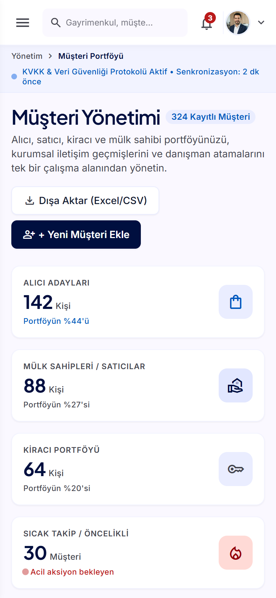
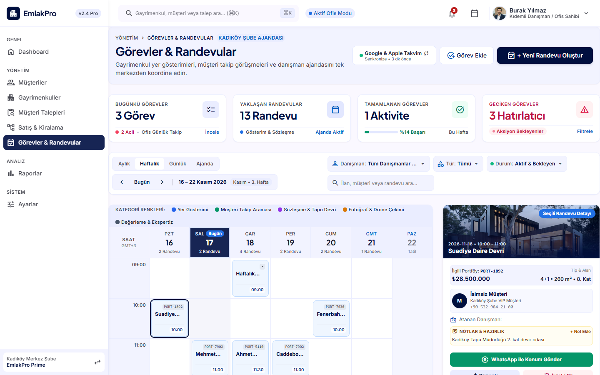
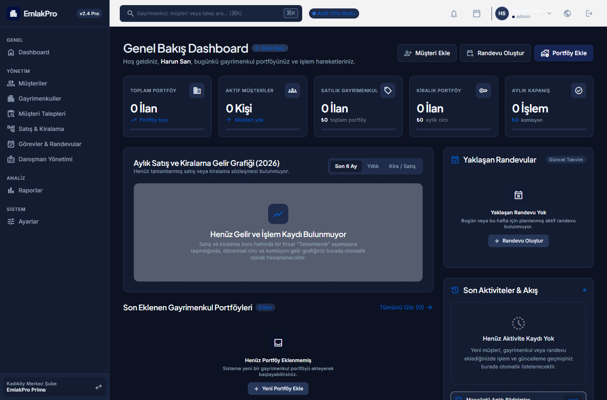

# 🏢 EmlakPro — Real Estate OS & Agency Management Platform

[](https://react.dev/)
[](https://vite.dev/)
[](https://tailwindcss.com/)
[](https://reactrouter.com/)
[](https://github.com/parallax/jsPDF)
[](https://oxc.rs/)

> **EmlakPro**, modern gayrimenkul ofislerinin ve profesyonel danışmanların portföy takibi, müşteri ilişkileri (CRM), satış/kiralama boru hatları (Kanban), randevu & ajanda takvimi, dinamik talep eşleştirme motoru ve analitik performans raporlamasını tek bir merkezden yürütebilmesi için geliştirilmiş kapsamlı bir **Frontend Web Uygulaması ve CRM Prototipidir**.

---

## 📌 Proje Kapsamı ve Güvenlik Bildirimi

> [!IMPORTANT]
> **Bu proje saf bir Frontend (Client-Side) SPA mühendislik çalışması ve prototipidir.**
> - **Backend & Veritabanı:** Uygulamada harici bir sunucu (Node.js/Express vb.), bulut backend veya ilişkisel veritabanı (PostgreSQL, MySQL, MongoDB vb.) bulunmamaktadır.
> - **Veri Saklama:** Tüm veriler (gayrimenkuller, müşteriler, talepler, görevler, randevular, ayarlar ve kullanıcılar) tarayıcının yerel depolama alanında (**HTML5 LocalStorage**) saklanmaktadır.
> - **Cihazlar Arası Senkronizasyon:** Farklı cihazlar veya farklı tarayıcı profilleri arasında otomatik bulut senkronizasyonu yoktur. Verilerin başka bir bilgisayara veya tarayıcıya aktarılması için **Ayarlar > Veri Yönetimi** sekmesindeki atomik **JSON Yedekleme / Geri Yükleme** aracı kullanılmalıdır.
> - **Kimlik Doğrulama ve Parola Güvenliği:** Uygulama içerisindeki kimlik doğrulama, tarayıcının yerel **Web Crypto API (SHA-256 + Salt)** mekanizmasıyla istemci tarafında özetlenerek (hash) çalışır. Bu yöntem yalnızca arayüz prototipini koruma ve rol bazlı deneyimi (Admin / Danışman) simüle etme amaçlıdır; **tek başına üretim ortamı güvenliği sağlamaz** ve sunucu taraflı güvenli kimlik doğrulamanın yerini tutmaz.
> - **Arayüz Simülasyonları:** Toplu SMS gönderimi, WhatsApp konum paylaşımı, Google/Outlook takvim entegrasyonu, emlak portalları API eşitlemesi ve 2FA (İki Aşamalı Doğrulama) seçenekleri; gerçek bir kurumsal sistemin kullanıcı deneyimini modellemek üzere kurgulanmış **arayüz simülasyonlarıdır**.

---

## 📸 Ekran Görüntüleri Galerisi

Aşağıdaki ekran görüntüleri, projenin `docs/screenshots/` dizininde yer alan güncel masaüstü ve mobil arayüz çıktılarıdır:

| Modül / Ekran | Masaüstü Görünümü (1440px) | Mobil Görünüm (390px) |
|---|---|---|
| **1. CRM Dashboard**<br>KPI kartları, kübik Bezier spline gelir grafiği, son ilanlar ve yaklaşan randevular |  |  |
| **2. Müşteri Yönetimi (CRM)**<br>8 kolonlu müşteri tablosu, filtreleme çubuğu, detay çekmecesi ve görüşme notları |  |  |
| **3. Gayrimenkul / Portföy**<br>Grid/Liste görünümü, sayfalama, galeri, filtreler ve istemci taraflı PDF sunum |  |  |
| **4. Müşteri Talepleri & Eşleşme**<br>Alıcı/kiracı talepleri, bütçe/bölge kriterleri ve anlık portföy eşleştirme motoru |  |  |
| **5. Satış ve Kiralama (Kanban)**<br>8 aşamalı anlaşma hunisi, sürükle-bırak aşama değişimi ve anlık GDV hesaplama |  |  |
| **6. Görevler & Randevular**<br>Haftalık matris, günlük zaman çizelgesi, mesai çizgisi ve dinamik danışman seçimi |  |  |
| **7. Raporlama & Analitik**<br>Ciro ligi, satış/kiralama grafikleri, bölgesel analiz ve CSV dışa aktarım |  |  |
| **8. Ayarlar & Veri Yönetimi**<br>Ofis profili, danışman kadrosu, atomik JSON yedekleme/geri yükleme ve sistem sağlığı |  |  |

### 🌙 Koyu Tema (Dark Mode) Görünümü
Uygulama genelinde ve tüm modüllerde sistem seviyesinde koyu tema desteği sunulmaktadır:


---

## ⚡ Modül Detayları ve Temel Özellikler

EmlakPro, gerçek kaynak kod mimarisine dayanan **11 temel modülden** oluşur:

### 1. CRM Dashboard (`/`, `/crm`, `/dashboard`)
- **Operasyonel Metrikler:** Aktif Portföy, Bekleyen Fırsat, Aylık Ciro, Günlük Randevu ve Sözleşme Uyarısı KPI göstergeleri.
- **Kübik Bezier Spline Grafiği:** Aylık ve yıllık dönem filtreli, veri noktası hover etkileşimli SVG gelir grafiği.
- **Hızlı İşlem Modalı (`QuickActionModal`):** Tek pencereden hızlı Müşteri, Randevu ve Gayrimenkul ekleme.
- **Canlı Özet Panelleri:** En son portföye giren gayrimenkuller, yaklaşan randevu akışı ve son müşteri aktiviteleri.

### 2. Müşteri Yönetimi (`/musteriler`)
- **Responsive Liste & Kart:** Masaüstünde 8 kolonlu zengin tablo; mobilde dokunmatik kart görünümüne otomatik adaptasyon.
- **Türkçe Karakter Duyarsız Canlı Arama:** `normalizeTurkishText` algoritmasıyla "ı/i, ş/s, ğ/g, ü/u, ö/o, ç/c" harf duyarsız anlık arama.
- **Müşteri Detay Çekmecesi (`CustomerDetailDrawer`):** İletişim bilgileri, etkileşim zaman çizelgesi (timeline), yeni görüşme notu ekleme.
- **Toplu İşlemler ($O(1)$ `Set` Mimarisi):** Çoklu müşteri seçimi, toplu SMS gönderimi (simülasyon) ve toplu danışman atama modalları.

### 3. Gayrimenkul / Portföy Yönetimi (`/gayrimenkuller`)
- **Çift Görünüm Desteği:** Kart (Grid) ve Tablo (Liste) modları arasında kayıpsız geçiş.
- **Gelişmiş Filtreleme & Sayfalama:** Kategori (Konut, Ticari, Arsa), Durum (Satılık, Kiralık), Fiyat aralığı, Oda sayısı ve İlçe filtreleri; 15'li sayfalama (pagination).
- **İstemci Taraflı Dinamik PDF Sunum Broşürü:** `jsPDF` motoruyla seçilen gayrimenkule ait yüksek kaliteli, vektörel portföy tanıtım PDF'ini tarayıcıda sıfır gecikmeyle üretme ve indirme.
- **İlan Yaşam Döngüsü:** Yeni ilan oluşturma, zengin görsel galerisi, favoriye alma/çıkarma, ilan güncelleme ve silme.

### 4. Müşteri Talepleri ve Eşleştirme Motoru (`/talepler`, `/musteri-talepleri`)
- **Talep Havuzu:** Alıcı ve kiracı taleplerinin bütçe, gayrimenkul tipi, oda sayısı ve hedef ilçe kriterleriyle listelenmesi.
- **Akıllı Eşleştirme Algoritması (`matchingAlgorithm.js`):** Seçilen müşteri talebini portföy havuzundaki tüm ilanlarla karşılaştırarak kriter ağırlıklarına göre yüzde uyum puanı (%95, %92 vb.) hesaplar ve en uygun gayrimenkulleri sıralar.
- **Hızlı Aksiyonlar:** Eşleşen portföy için e-katalog paylaşımı ve doğrudan randevu oluşturma.

### 5. Satış ve Kiralama Kanban Hattı (`/satis-ve-kiralama`)
- **8 Aşamalı Satış Hunisi:** *Yeni Fırsat ➔ İlk Görüşme ➔ Yer Gösterimi ➔ Teklif ➔ Pazarlık ➔ Sözleşme ➔ Tamamlandı ➔ Kaybedildi*.
- **Sürükle-Bırak & Tek Tıkla Aşama İlerletme:** HTML5 Drag & Drop ve kart üzerindeki hızlı butonlarla aşamalar arası geçiş.
- **Tek Geçişli $O(N)$ Gruplama:** `dealsByStage` ile tüm anlaşma hacmi (GDV - Gross Deal Value) ve sütun toplamları anlık olarak hesaplanır.
- **Kapanış Detayları:** Tamamlanan işlemlerde satış/kiralama kapanış tarihi, komisyon tutarı ve süreç notlarının kaydedilmesi.
- **Mobil Aşama Navigatörü:** Mobilde 8 aşama arasında hızlı geçiş sağlayan durum hapları.

### 6. Görevler ve Randevular (`/gorevler-ve-randevular`, `/gorevler`, `/randevular`)
- **4 Farklı Takvim Görünümü:** Haftalık Matris, Günlük Zaman Çizelgesi, Aylık Izgara ve Ajanda Listesi.
- **Mesai Çizgisi Göstergesi:** Çalışma saatleri (09:00 - 18:30) içinde piksel hassasiyetinde kırmızı canlı zaman çizgisi.
- **Dinamik Danışman Entegrasyonu:** `useAuth()` ile oturum açan kullanıcıyı varsayılan atama olarak alma; sadece aktif danışmanları seçim listesine dahil etme.
- **Görev Yönetimi:** Görev oluşturma, tamamlandı olarak işaretleme, filtreleme ve silme.
- **Randevu Planlama:** Müşteri, gayrimenkul, tarih, saat ve konum bilgisiyle randevu takibi.

### 7. Raporlama ve Analitik (`/raporlar`)
- **İstemci Taraflı Analitik Motoru (`reportsAggregator.js`):** Ciro, net komisyon, satış/kiralama oranları ve ortalama işlem süresi hesaplamaları.
- **Dönem Filtreleri:** Tüm Zamanlar, Bu Ay, Son 3 Ay, Bu Yıl ve Özel Tarih Aralığı modalı.
- **Danışman Ciro Ligi:** Kolon bazında (Ciro, İşlem Sayısı, Komisyon) dinamik sıralanabilir danışman performans tablosu.
- **Bölgesel Talep Dağılımı:** İlçe bazlı işlem hacmi ve talep yoğunluğu haritası.
- **Dışa Aktarma (Export):** Raporlama ve analitik verilerini anında CSV formatında dışa aktarma.

### 8. Ayarlar ve Veri Yönetimi (`/ayarlar` - Yalnızca Yönetici)
- **Modüler Sekme Mimarisi:** Ofis Profili, Danışman Kadrosu, Portallar, Komisyon Oranları, Şablonlar, Güvenlik, Veri Yönetimi ve Görünüm.
- **Atomik JSON Yedekleme & Geri Yükleme:** Tüm `localStorage` verilerini doğrulanabilir `.json` dosyası olarak indirme ve yedekten geri yükleme.
- **Sistem Sağlık Şeridi:** Portföy, müşteri ve anlaşma sayılarının anlık sağlık özeti.
- **Clean Slate (Temiz Başlangıç):** Verileri sıfırlayıp temiz kurulum yöneticisi tanımlama imkânı.

### 9. Halka Açık İlan Portalı (`/`, `/ilanlar`, `/ilanlar/:id`, `/iletisim`, `/talep-birak`)
- **Ziyaretçi Arayüzü (`PortalLayout`):** Kimlik doğrulama gerektirmeden ziyaretçilerin ilanları inceleyebildiği müşteri vitrini.
- **Filtreli İlan Arama:** Fiyat, konum ve mülk tipine göre anlık filtreleme.
- **İlan Detay Sayfası:** Fotoğraf galerisi, teknik özellikler ve doğrudan danışmanla iletişim kartı.
- **Otomatik CRM Entegrasyonu:** Web sitesinden mesaj gönderen veya talep bırakan ziyaretçilerin bilgileri otomatik olarak normalize edilerek CRM Müşteri ve Talep veritabanına eklenir.

### 10. Danışman ve Kullanıcı Yönetimi (`/giris`, `/danismanlar` - Yalnızca Yönetici)
- **Rol Tabanlı Erişim Denetimi (RBAC):** **Yönetici (Admin)** ve **Gayrimenkul Danışmanı (Consultant)** yetkilendirme katmanı.
- **Oturum Yönetimi (`useAuth` & `ProtectedRoute`):** Korumalı CRM rotaları ve yetkisiz erişim yönlendirmeleri.
- **Danışman Yönetim Konsolu:** Yeni danışman ekleme, düzenleme, aktif/pasif durumu ve şifre güncelleme.
- **Web Crypto API Güvenliği:** Şifreler düz metin olarak değil, SHA-256 + salt ile istemci tarafında özetlenerek saklanır.

### 11. Açık / Koyu Tema (Dark Mode & System Preference)
- **3 Tema Modu:** Açık Tema (Light), Koyu Tema (Dark) ve İşletim Sistemi Tercihi (System).
- **Anti-Flicker Pre-render:** `index.html` başında çalışan hafif kontrol scripti sayesinde F5 sayfa yenilemelerinde beyaz parlama (FOUC) yaşanmaz.
- **Eşzamanlı Sekme Senkronizasyonu:** Bir sekmede değiştirilen tema diğer açık sekmelere anında yansır.

---

## 🛠️ Kullanılan Teknolojiler ve Doğrulanmış Sürümler

Aşağıdaki liste `package.json` ve `package-lock.json` dosyalarından birebir doğrulanmış gerçek sürümleri içermektedir:

| Teknoloji / Kütüphane | package.json Tanımı | Kilitli & Kurulu Sürüm | Türü | Kullanım Alanı ve Amacı |
|---|---|---|---|---|
| **React** | `^19.3.1` | `19.3.1` | Dependency | Reaktif kullanıcı arayüzü, Concurrent Rendering ve Hook mimarisi |
| **React DOM** | `^19.3.1` | `19.3.1` | Dependency | React bileşen ağacının tarayıcı DOM eşlemesi |
| **React Router DOM** | `^7.18.5` | `7.18.5` | Dependency | İstemci taraflı deklaratif yönlendirme, rol bazlı rota koruması |
| **Tailwind CSS** | `^3.4.19` | `3.4.19` | DevDependency | Utility-first responsive stil sistemi, Dark Mode ve tasarım tokenları |
| **Vite** | `^8.3.6` | `8.3.7` | DevDependency | Yüksek performanslı derleyici, HMR (Hot Module Replacement) |
| **jsPDF** | `^4.2.1` | `4.2.1` | Dependency | İstemci tarafında dinamik gayrimenkul sunum broşürü (PDF) üretimi |
| **Oxlint** | `^1.90.0` | `1.92.0` | DevDependency | Rust tabanlı ultra hızlı statik kod analizi (0 Hata / 0 Uyarı) |
| **Puppeteer Core** | `^25.16.0` | `25.16.0` | DevDependency | Headless Chromium üzerinden E2E, responsive ve regresyon testleri |
| **PostCSS & Autoprefixer** | `^8.5.32` / `^10.6.2` | `8.5.36` / `10.6.2` | DevDependency | CSS dönüşümleri ve tarayıcı ön eklerinin otomatik eklenmesi |
| **Material Symbols Outlined** | Web Font | Google Font | Arayüz genelinde tutarlı ikonografik tasarım dili |

---

## 📁 Mimari ve Proje Klasör Yapısı

```
emlakpro-real-estate-os/
├── docs/
│   ├── screenshots/              # Modül masaüstü ve mobil ekran görüntüleri (PNG)
│   ├── technical_interview_qa.md # Frontend teknik mülakat soru ve cevapları
│   └── cv_project_description.md # CV ve portföy hazır proje açıklamaları
├── public/
│   ├── _redirects                # Netlify SPA yönlendirme kuralı
│   └── favicon.svg               # Uygulama logosu
├── scripts/
│   ├── generate_screenshots.mjs  # Otomatik ekran görüntüsü alma aracı
│   ├── test_theme_persistence.mjs# Tema kalıcılığı E2E doğrulama testi
│   ├── test_stage_3_5_final_regression.mjs # 8 ekran final regresyon testi
│   ├── test_customers_render_optimization.mjs # Müşteriler render izolasyon testi
│   ├── test_reports_render_optimization.mjs   # Raporlar render izolasyon testi
│   ├── test_properties_render_optimization.mjs# Portföy render izolasyon testi
│   ├── test_kanban_render_optimization.mjs    # Kanban tek geçiş izolasyon testi
│   ├── test_dashboard_render_optimization.mjs # Dashboard spline hover testi
│   ├── test_toast_system.mjs     # Merkezi Toast sistemi E2E testi
│   └── test_responsive_screens.mjs# 5 viewports x 8 ekran yatay taşma testi
├── src/
│   ├── components/
│   │   ├── auth/                 # ProtectedRoute vb. yetkilendirme bileşenleri
│   │   ├── common/               # ErrorBoundary, ErrorState, Logo
│   │   ├── customers/            # Müşteri tablosu, filtre çubuğu, detay çekmecesi
│   │   ├── dashboard/            # Bento grid kartları, hızlı işlem modalları
│   │   ├── deals/                # 8 aşamalı Kanban panosu, anlaşma kartları
│   │   ├── layout/               # Header, Sidebar, AppLayout
│   │   ├── properties/           # Portföy kartları, liste tablosu ve modallar
│   │   ├── reports/              # Gelir grafiği, danışman ligi tablosu, KPI'lar
│   │   ├── requests/             # Talep listesi ve eşleştirme konsolu
│   │   ├── settings/             # Sistem ayarları sekme bileşenleri
│   │   ├── tasks/                # Takvim matrisi, randevu kartları ve araç çubuğu
│   │   └── ui/                   # BaseDrawer, ConfirmDeleteModal, Toast, Skeletons
│   ├── context/
│   │   ├── AuthContext.jsx       # Kimlik doğrulama Provider bileşeni
│   │   ├── ToastContext.jsx      # Merkezi bildirim Provider bileşeni
│   │   └── ToastContextCore.js   # Fast Refresh uyumlu Context instance & hook
│   ├── hooks/
│   │   ├── useAuth.js            # Kullanıcı oturum ve rol erişim kancası
│   │   ├── useLocalStorage.js    # Reaktif ve sekmeler arası senkron depolama kancası
│   │   ├── useModalBehavior.js   # ESC, Backdrop ve Scroll-lock kontrol kancası
│   │   └── useToast.js           # Toast bildirim tetikleme kancası
│   ├── layouts/
│   │   └── portal/               # Halka açık müşteri vitrini mizanpajı (PortalLayout)
│   ├── pages/                    # React.lazy ile dinamik bölümlenmiş 13 ana sayfa
│   ├── router/
│   │   ├── AppRouter.jsx         # React Router v7 rota haritası ve alias tanımları
│   │   └── SmartRootSwitcher.jsx # Ziyaretçi / Giriş yapmış kullanıcı kök yönlendirici
│   ├── services/
│   │   ├── mockData.js           # Başlangıç portföy, müşteri ve anlaşma tohum verisi
│   │   └── reportsAggregator.js  # İstemci analitik hesaplama ve agregasyon motoru
│   └── utils/
│       ├── cleanSlate.js         # Sıfırdan temiz kurulum ve başlangıç yönetici tohumlayıcı
│       ├── matchingAlgorithm.js  # Talep-portföy puanlama ve eşleştirme algoritması
│       ├── pdfGenerator.js       # Dinamik jsPDF sunum broşürü üreticisi
│       ├── taskHelpers.js        # Tarih ve hafta normalizasyon yardımcıları
│       ├── themeHelper.js        # Merkezi açık/koyu tema yöneticisi
│       ├── turkishSearch.js      # Türkçe karakter duyarsız arama motoru
│       └── validation.js         # Telefon, e-posta ve bütçe validasyon kuralları
├── index.html                    # Uygulama giriş noktası ve Anti-flicker tema scripti
├── vercel.json                   # Vercel SPA rewrite yapılandırması
├── tailwind.config.js            # Renk paletleri, fontlar ve koyu tema yapılandırması
├── vite.config.js                # Vite derleme ayarları
└── package.json                  # Proje bağımlılıkları ve npm komutları
```

---

## 🚀 Kurulum ve Çalıştırma Rehberi (Windows & Genel)

Aşağıdaki adımlar özellikle **Windows** geliştirme ortamı (PowerShell, CMD veya Git Bash) ve Unix tabanlı sistemler için doğrulanmıştır:

### Sistem Gereksinimleri
- **Node.js**: v18.0.0 veya üzeri (LTS sürümü önerilir)
- **Paket Yöneticisi**: npm (v9+) veya yarn

### 1. Depoyu Klonlayın ve Proje Dizinine Girin
```bash
git clone https://github.com/haruunsarii/-emlakpro-real-estate-os.git
cd ./-emlakpro-real-estate-os
```

### 2. Bağımlılıkları Yükleyin
```bash
npm install
```

### 3. Geliştirme Sunucusunu Başlatın
```bash
npm run dev
```
Konsolda görünen yerel geliştirme adresini tarayıcınızda açın:
```
http://localhost:5173
```

### 4. Statik Kod Analizi (Linter)
```bash
npm run lint
```
*Oxlint ile tüm kaynak kod denetlenir (Hedef: 0 hata, 0 uyarı).*

### 5. Production Derlemesi Oluşturun
```bash
npm run build
```
*Optimize edilmiş statik web varlıkları `dist/` dizinine derlenir.*

### 6. Yerel Production Önizleme
```bash
npm run preview
```
*Derlenen `dist/` paketinin yerel bir statik sunucuda test edilmesini sağlar.*

---

## 🧪 Test ve Kalite Güvencesi (QA)

EmlakPro, gerçek Chromium tarayıcısı üzerinde çalışan Puppeteer E2E test paketleriyle düzenli olarak doğrulanmıştır:

| Test Dosyası | Test Kapsamı ve Senaryolar | Başarı Durumu |
|---|---|---|
| `test_stage_3_5_final_regression.mjs` | 8 ana ekran, 4 rota alias'ı, 7 kritik kullanıcı akışı, konsol hatasızlığı | ✅ %100 Başarılı |
| `test_responsive_screens.mjs` | 5 farklı ekran çözünürlüğü x 8 ekran (40 viewport kontrolü), 0px yatay taşma | ✅ %100 Başarılı |
| `test_theme_persistence.mjs` | Koyu/Açık tema geçişi, F5 sonrası kalıcılık, localStorage senkronizasyonu | ✅ %100 Başarılı |
| `test_customers_render_optimization.mjs` | Checkbox seçimi DOM mutasyon izolasyonu, detay çekmecesi yalıtımı | ✅ %100 Başarılı |
| `test_kanban_render_optimization.mjs` | 8 aşama Kanban huni hesaplaması, sürükle-bırak aşama taşıma, tarih kuralları | ✅ %100 Başarılı |
| `test_reports_render_optimization.mjs` | KPI seçimi izolasyonu, ciro ligi kolon sıralaması, grafik modları | ✅ %100 Başarılı |
| `test_properties_render_optimization.mjs` | 15'li sayfalama, favori kart DOM yalıtımı, anlık arama performansı | ✅ %100 Başarılı |
| `test_dashboard_render_optimization.mjs` | Bezier spline hover geometri invariansı, bento kart etkileşimi | ✅ %100 Başarılı |
| `test_toast_system.mjs` | 4 bildirim türü, ARIA rolleri, otomatik kapanma, deduplication | ✅ %100 Başarılı |

---

## 🌐 Dağıtım (Deployment)

Uygulama istemci taraflı (SPA) olarak derlenir ve statik hosting platformlarına (Vercel, Netlify, GitHub Pages, Cloudflare Pages) doğrudan yüklenebilir:

### Vercel Dağıtımı
Kök dizindeki `vercel.json` dosyası, tüm alt rotaların (`/musteriler`, `/gayrimenkuller`, `/satis-ve-kiralama` vb.) doğrudan `index.html`'e yönlendirilmesini garanti eder:
```json
{
  "rewrites": [{ "source": "/(.*)", "destination": "/index.html" }]
}
```

### Netlify Dağıtımı
`public/_redirects` dosyası derleme sırasında otomatik olarak `dist/_redirects` konumuna kopyalanır:
```
/*    /index.html   200
```
