# 🏢 EmlakPro — Real Estate OS & Agency Management Platform

[](https://react.dev/)
[](https://tailwindcss.com/)
[](https://vitejs.dev/)
[](https://reactrouter.com/)
[](https://oxc.rs/)
[](https://opensource.org/licenses/MIT)

> **EmlakPro**, modern gayrimenkul ofislerinin portföy yönetimi, müşteri ilişkileri (CRM), satış/kiralama boru hatları (Kanban), interaktif randevu takvimi ve analitik performans raporlamasını tek bir merkezden yöneten, kurumsal ölçekli bir **Frontend Web Uygulamasıdır**.

---

## 📌 Proje Kapsamı ve Önemli Açıklama

> [!NOTE]
> **Bu proje saf bir Frontend (Client-Side) mühendislik çalışmasıdır.**
> - Uygulamada harici bir backend, veritabanı sunucusu veya gerçek API sunucusu bulunmamaktadır.
> - Tüm veri akışı ve kalıcılık **HTML5 LocalStorage** üzerinde reaktif, senkronize ve versiyonlanmış (`_v1`) özel custom hook mimarisiyle (`useLocalStorage`) yönetilmektedir.
> - **Simülasyon Özellikleri:** Toplu SMS gönderimi, WhatsApp konumu paylaşımı, Google/Outlook takvim senkronizasyonu, emlak portalları API eşitlemesi ve iki aşamalı doğrulama (2FA) özellikleri; kurumsal kullanıcı deneyimini (UX) eksiksiz yaşatmak adına tasarlanmış **arayüz simülasyonlarıdır**.

---

## 🎯 Projenin Amacı

Gayrimenkul sektöründeki danışman ve ofis yöneticilerinin karmaşık operasyonlarını hızlandırmak; ilan listelemeden müşteri talebi eşleştirmeye, Kanban hunisinden dinamik PDF portföy sunumu oluşturmaya kadar tüm süreçleri modern bir arayüzde yüksek performans, sıfır layout shift (CLS) ve %100 responsive uyum ile sunmaktır.

---

## 📸 Ekran Görüntüleri (Masaüstü & Mobil)

| Modül / Ekran | Masaüstü Görünümü (1440px) | Mobil Görünüm (390px) |
|---|---|---|
| **1. Dashboard**<br>KPI metrikleri, spline gelir grafiği, son ilanlar & yaklaşan randevular | 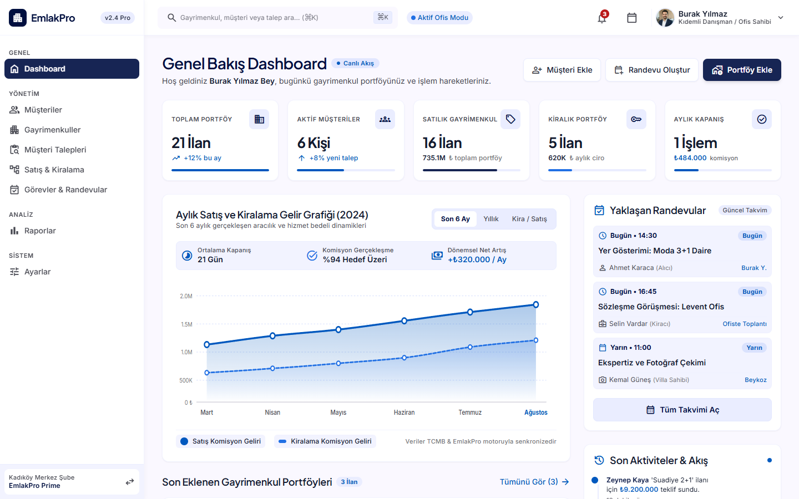 | 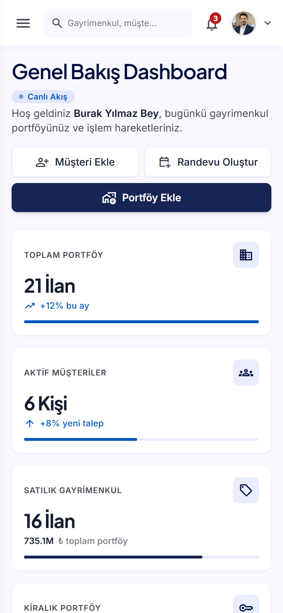 |
| **2. Müşteriler (CRM)**<br>8 kolonlu tablo, filtre çubuğu, detay çekmecesi & timeline notları | 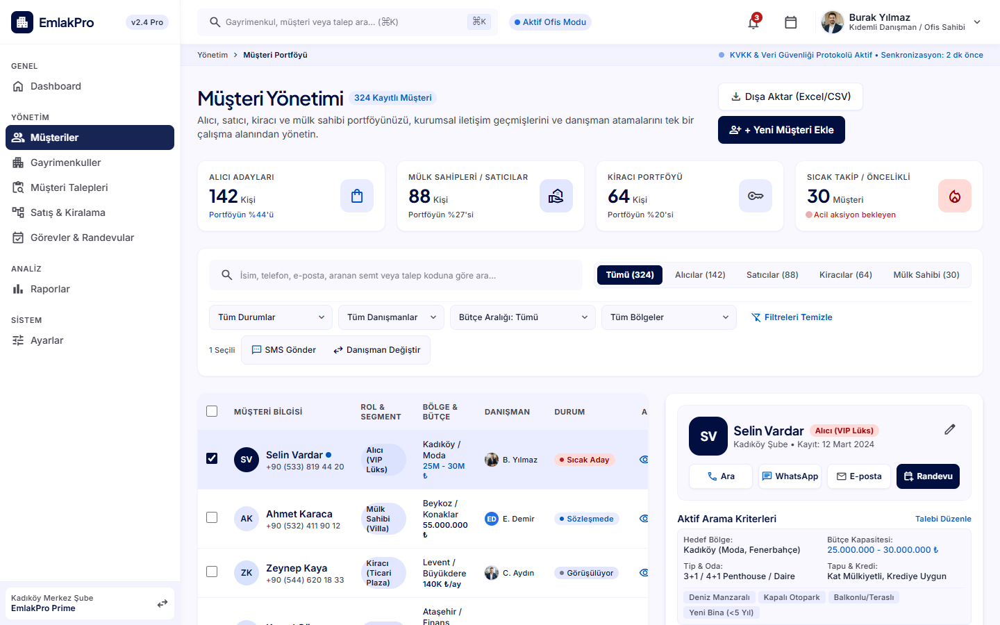 |  |
| **3. Gayrimenkuller**<br>21 ilan, 15'li sayfalama, galeri, filtreler & istemci taraflı PDF sunum | 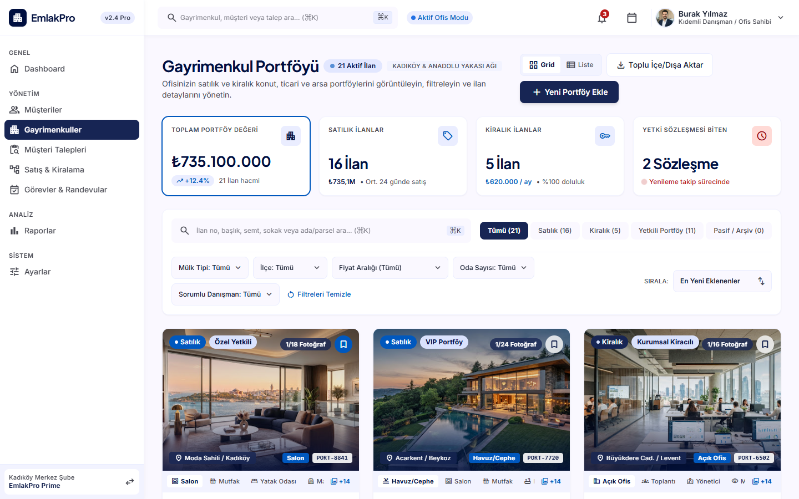 | 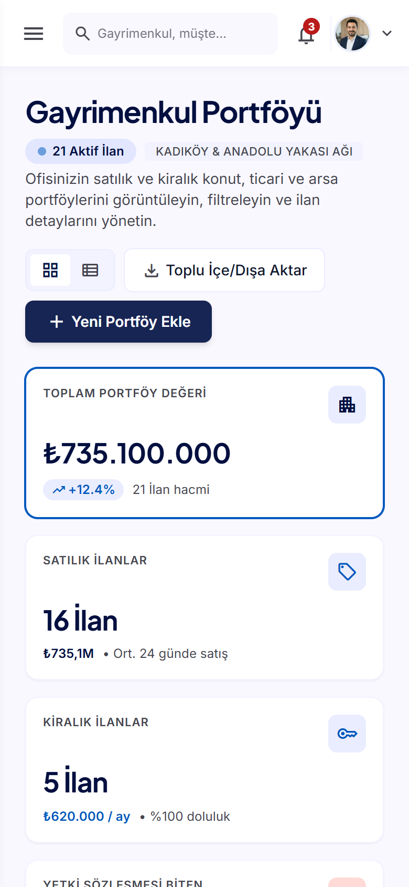 |
| **4. Talepler & AI Eşleşme**<br>Alıcı talepleri, bütçe/bölge kriterleri & anlık portföy eşleştirme | 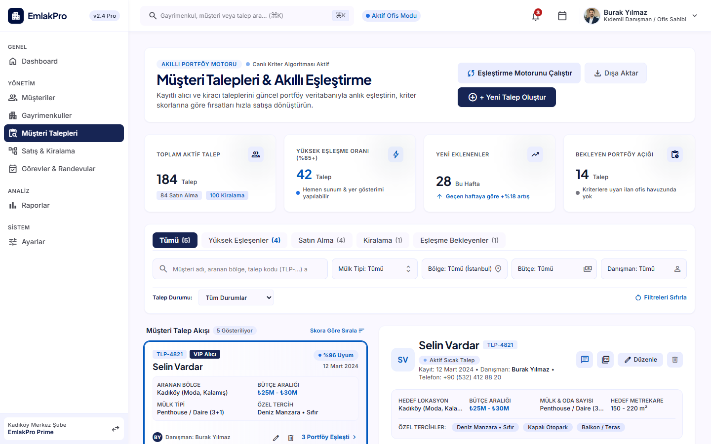 | 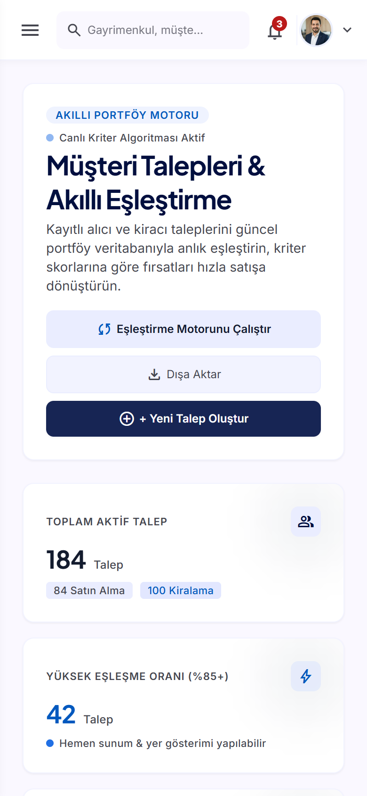 |
| **5. Satış ve Kiralama**<br>8 aşamalı Kanban panosu, GDV hacim hesapları & hızlı aşama ilerletme | 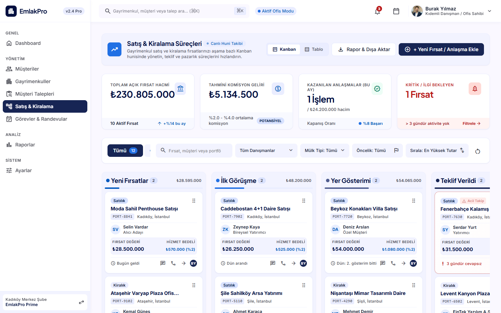 | 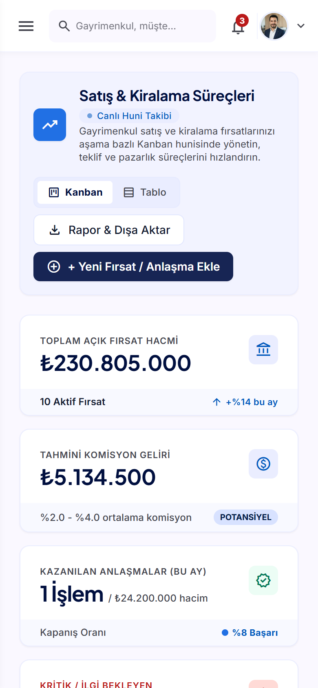 |
| **6. Görevler & Randevular**<br>Haftalık/Günlük/Aylık/Ajanda matrisi & mesai saati zaman çizgisi |  | 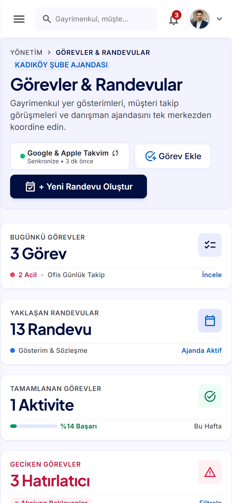 |
| **7. Raporlar & Analitik**<br>Danışman ciro ligi, bölgesel talep analizi & SVG analitik grafikleri | 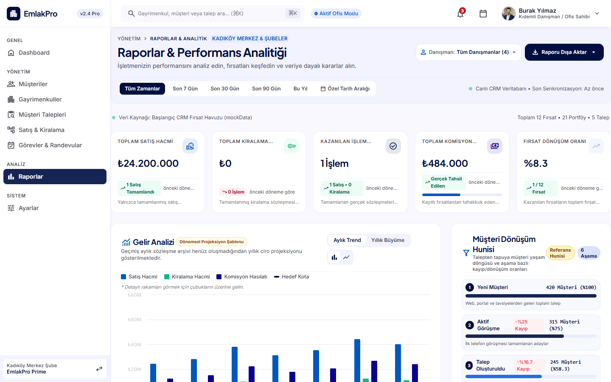 | 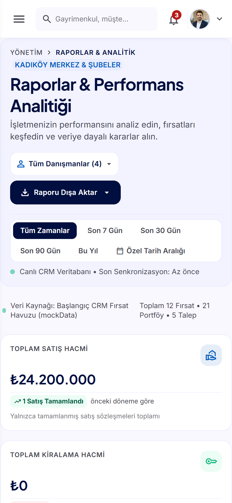 |
| **8. Ayarlar & Sistem**<br>9 sekme yapılandırması, atomik JSON yedekleme/geri yükleme & sistem sağlığı | 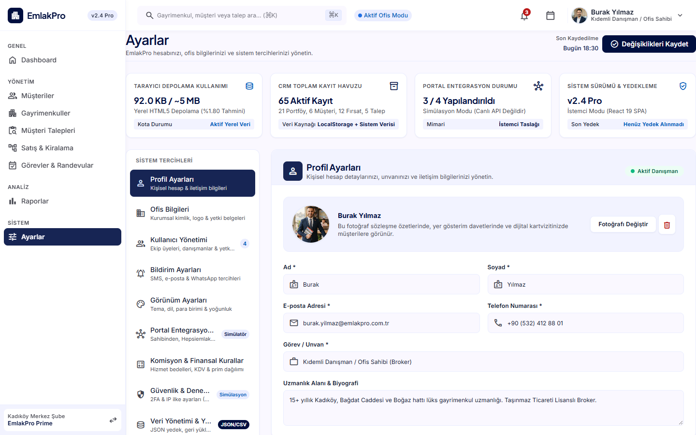 | 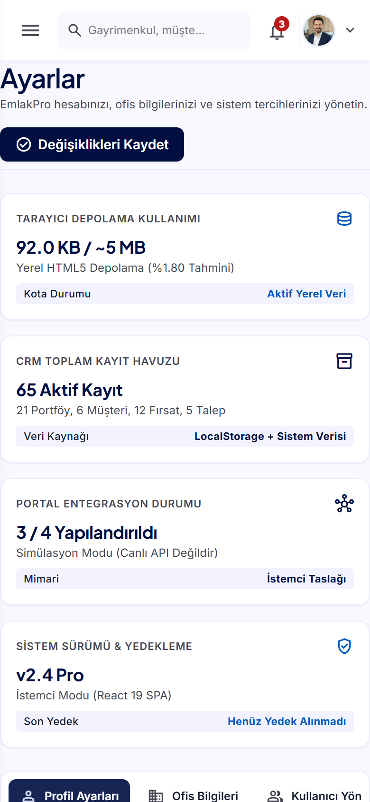 |

---

## ⚡ Temel Özellikler

### 1. Operasyonel Dashboard (`/`)
- Canlı durum göstergeli 5 KPI kartı (Aktif Portföy, Bekleyen Fırsat, Aylık Ciro, Günlük Randevu, Sözleşme Uyarısı).
- Kübik Bezier spline enterpolasyonlu interaktif gelir grafiği (aylık/yıllık filtreler, hover anında geometri koruması).
- Tek tıkla Hızlı İşlem Modalları (`QuickActionModal`: Müşteri, Randevu ve İlan ekleme).

### 2. Müşteri Yönetimi & CRM (`/musteriler`)
- 8 kolonlu müşteri tablosu; mobilde dokunmatik kart görünümüne otomatik dönüşüm.
- Türkçe karakter duyarsız anlık arama (`normalizeTurkishText`: "ı/i, ş/s, ğ/g, ü/u, ö/o, ç/c" normalizasyonu).
- Müşteri profil çekmecesi: etkileşim geçmişi, zaman çizelgesi (timeline), yeni görüşme notu ekleme.
- Toplu işlemler: Çoklu seçim ($O(1)$ `Set` mimarisi), toplu SMS ve danışman atama modalları.

### 3. Portföy Yönetimi (`/gayrimenkuller`)
- Tam 21 aktif gayrimenkul kaydı (16 Satılık / 5 Kiralık dengesi).
- 15'li sayfalama (Sayfa 1: 15 ilan, Sayfa 2: 6 ilan) ve filtre değişiminde otomatik sayfa sıfırlama.
- Grid (zengin kart) ve Liste (veri tablosu) görünüm geçişi.
- Tarayıcı üzerinde dinamik PDF sunum oluşturucu (`jsPDF` ile anında tek/çoklu sayfa portföy broşürü).
- Çoklu fotoğraf galerisi ve thumbnail seçimi.

### 4. Müşteri Talepleri & Akıllı Eşleştirme (`/talepler`)
- Alıcı talepleri listesi, durum rozetleri ve bütçe aralıkları.
- Talep seçildiğinde portföy havuzundaki ilanlarla kriterleri karşılaştırıp %95, %92 gibi uyum skorları üreten istemci taraflı eşleştirme motoru.
- E-Katalog paylaşım ve randevu oluşturma aksiyonları.

### 5. Satış & Kiralama Kanban Hattı (`/satis-ve-kiralama`)
- 8 aşamalı anlaşma hunisi (*Yeni Fırsat ➔ İlk Görüşme ➔ Yer Gösterimi ➔ Teklif ➔ Pazarlık ➔ Sözleşme ➔ Tamamlandı ➔ Kaybedildi*).
- Tek geçişli $O(N)$ gruplama (`dealsByStage`) ile ₺230.2M GDV satış hacminin anlık hesaplanması.
- Kart üzerinden tek tıkla aşama ilerletme/geri alma ve tarih kuralları (`firstCompletedAt`, `completedAt`).
- Mobilde 8 aşama navigatör hapları ile tek dokunuşla aşamaya odaklanma.

### 6. Görevler & Randevu Takvimi (`/gorevler-ve-randevular`)
- 4 farklı takvim görünümü: **Haftalık Matris**, **Aylık Izgara**, **Günlük Zaman Çizelgesi** ve **Ajanda Listesi**.
- Mesai saatleri (09:00 - 18:30) içinde piksel hassasiyetinde kırmızı canlı zaman çizgisi göstergesi.
- Randevu oluşturma, düzenleme, tamamlama, erteleme ve silme akışları.

### 7. Raporlar & Performans Analitiği (`/raporlar`)
- İstemci taraflı analitik agregatörü (`reportsAggregator.js`): Ciro, komisyon, dönüşüm oranları ve satış/kiralama karşılaştırmaları.
- Kolon bazlı dinamik sıralanabilir danışman ciro ligi tablosu.
- İlçe bazlı talep yoğunluğu analizi.
- Raporları CSV formatında anında dışa aktarma.

### 8. Sistem Ayarları & Yedekleme (`/ayarlar`)
- 9 sekme: Ofis Profili, Danışman Kadrosu, Portallar, Komisyon Oranları, Şablonlar, Güvenlik, Veri Yönetimi.
- **Atomik Yedekleme:** Tüm uygulama verisini tek tıkla `.json` olarak indirme ve doğrulama denetimli atomik geri yükleme.
- Sistem Sağlık Şeridi: Kayıtlı ilan, müşteri ve anlaşma sayılarının anlık özeti.

### 9. Halka Açık Müşteri Vitrini & Portalı (`/ilanlar`, `/iletisim`, `/talep-birak`)
- Müşterilerin gayrimenkul portföyünü inceleyebildiği, zengin fotoğraf galerisi ve oda/fiyat/bölge filtreleriyle filtreleyebildiği responsive vitrin.
- **İletişim & Otomatik CRM Kaydı:** Mesaj gönderen veya talep bırakan kişilerin GSM numaraları normalize edilerek anında CRM `Müşteriler` havuzuna aktarılır; mükerrer kayıt engellenir.

### 10. Kimlik Doğrulama & Danışman Yönetimi (`/giris`, `/danismanlar`)
- **Web Crypto API (SHA-256 + Salt):** Güvenli istemci taraflı şifreleme; düz metin parola tutulmaz.
- Çoklu rol yönetimi: **Yönetici (Admin)** ve **Gayrimenkul Danışmanı** yetkilendirmesi.
- İlk açılışta `SetupInitialAdminModal` ile temiz kurulum (Clean Slate) yöneticisi tanımlama.

### 11. Kalıcı Koyu Tema & Sistem Tercihi Uyumu (Dark Mode)
- Açık Tema, Koyu Tema ve İşletim Sistemi Tercihi (`system`) modları.
- Anti-Flicker Pre-render: F5 sayfa yenilemelerinde beyaz parlama olmadan DOM seviyesinde anında tema kalıcılığı.
- Sekmeler arası eşzamanlı reaktif tema senkronizasyonu.

---

## 🛠️ Kullanılan Teknolojiler

| Alan | Kütüphane / Teknoloji | Versiyon | Kullanım Amacı |
|---|---|---|---|
| **Core** | React | `^19.3.1` | Modern bileşen mimarisi, Hooks & Concurrent rendering |
| **DOM** | React DOM | `^19.3.1` | React ağacının DOM eşlemesi |
| **Routing** | React Router DOM | `^7.18.5` | SPA istemci taraflı dinamik yönlendirme, route code splitting |
| **Styling** | Tailwind CSS | `^3.4.19` | Utility-first responsive stil sistemi & design tokens |
| **Build Tool** | Vite | `^8.3.6` | HMR (Hot Module Replacement) & optimize Rollup derleyici |
| **Linter** | Oxlint | `^1.90.0` | Ultra hızlı Rust tabanlı JavaScript/React static linter (0 Hata/0 Uyarı) |
| **PDF Engine**| jsPDF | `^4.2.1` | İstemci tarafında vektörel gayrimenkul sunum broşürü üretimi |
| **Testing** | Puppeteer Core | `^25.16.0` | Headless Chrome ile 5 viewports E2E ve DOM mutasyon izolasyon testleri |
| **Icons** | Material Symbols Outlined | Google Font | Tutarlı ve hafif Google ikon font ailesi |

---

## 📁 Proje Klasör Yapısı

```
emlak-uygulamasi/
├── docs/
│   ├── screenshots/              # 16 adet masaüstü ve mobil ekran görüntüsü
│   ├── technical_interview_qa.md # Frontend teknik mülakat soru & cevapları
│   └── cv_project_description.md # CV için hazır proje açıklamaları
├── public/
│   ├── _redirects                # Netlify SPA yönlendirme kuralı
│   └── favicon.svg               # Vektörel uygulama ikonu
├── scripts/
│   ├── generate_screenshots.mjs  # Otomatik ekran görüntüsü alma aracı
│   ├── test_stage_3_5_final_regression.mjs # 8 ekran final regresyon testi
│   ├── test_customers_render_optimization.mjs # Müşteriler render izolasyon testi
│   ├── test_reports_render_optimization.mjs   # Raporlar render izolasyon testi
│   ├── test_properties_render_optimization.mjs# Portföy render izolasyon testi
│   ├── test_kanban_render_optimization.mjs    # Kanban tek geçiş izolasyon testi
│   ├── test_dashboard_render_optimization.mjs # Dashboard spline hover testi
│   ├── test_toast_system.mjs     # Merkezi Toast sistemi E2E testi
│   └── test_responsive_screens.mjs# 5 viewports x 8 ekran yatay taşma testi
├── src/
│   ├── components/
│   │   ├── common/               # ErrorBoundary, ErrorState vb.
│   │   ├── customers/            # Müşteri tablosu, filtreleri ve drawer
│   │   ├── dashboard/            # Bento grid kartları, hızlı işlem modalları
│   │   ├── deals/                # Kanban panosu, sütunları ve anlaşma kartları
│   │   ├── layout/               # Header, Sidebar, AppLayout
│   │   ├── properties/           # Portföy zengin kartları, listesi ve modalları
│   │   ├── reports/              # Gelir grafiği, liderlik tablosu ve KPI'lar
│   │   ├── requests/             # Talep listesi ve eşleştirme konsolu
│   │   ├── settings/             # Sistem ayarları sekme bileşenleri
│   │   ├── tasks/                # Takvim matrisi, randevu kartları ve araç çubuğu
│   │   └── ui/                   # BaseDrawer, ConfirmDeleteModal, Toast, Skeletons
│   ├── context/
│   │   ├── ToastContext.jsx      # Merkezi Toast Provider bileşeni
│   │   └── ToastContextCore.js   # Fast Refresh uyumlu Context instance & hook
│   ├── hooks/
│   │   ├── useLocalStorage.js    # Reaktif, senkronize localStorage kancası
│   │   ├── useModalBehavior.js   # ESC, Backdrop & Scroll-lock modal kontrolcüsü
│   │   └── useToast.js           # Toast tetikleme arayüz kancası
│   ├── pages/                    # 8 ana ekran (React.lazy dinamik importlu)
│   ├── router/
│   │   └── AppRouter.jsx         # React Router v7 rota tanımları & alias'lar
│   ├── services/
│   │   ├── mockData.js           # 21 portföy ve ilişkili zengin tohum verisi
│   │   └── reportsAggregator.js  # İstemci taraflı analitik hesaplama motoru
│   └── utils/
│       ├── matchingAlgorithm.js  # Talep-portföy puanlama algoritması
│       ├── pdfGenerator.js       # Dinamik jsPDF sunum üretici
│       ├── taskHelpers.js        # Tarih ve hafta normalizasyon yardımcıları
│       ├── turkishSearch.js      # Türkçe karakter duyarsız arama motoru
│       └── validation.js         # Telefon, e-posta ve bütçe validasyon kuralları
├── vercel.json                   # Vercel SPA rewrite yapılandırması
├── tailwind.config.js            # Design tokens, renk paletleri ve spacing
├── vite.config.js                # Vite yapılandırması
└── package.json                  # Bağımlılıklar ve npm scriptleri
```

---

## 🚀 Kurulum ve Çalıştırma

Projeyi yerel makinenizde çalıştırmak için aşağıdaki adımları izleyin:

### Gereksinimler
- Node.js (v18 veya üzeri önerilir)
- npm veya yarn

### 1. Depoyu klonlayın ve dizine girin
```bash
git clone https://github.com/kullanici-adi/emlakpro-real-estate-os.git
cd emlakpro-real-estate-os
```

### 2. Bağımlılıkları yükleyin
```bash
npm install
```

### 3. Geliştirme sunucusunu başlatın
```bash
npm run dev
```
Tarayıcınızda `http://localhost:5173` adresini açarak uygulamayı kullanmaya başlayabilirsiniz.

### 4. Statik Kod Analizi (Linter)
```bash
npm run lint
```
*Tüm kaynak kod Oxlint ile denetlenir (Hedef: 0 hata, 0 uyarı).*

### 5. Production Derlemesi
```bash
npm run build
```
*Derleme çıktısı `dist/` klasörüne oluşturulur (~4 saniye).*

### 6. Yerel Production Önizleme
```bash
npm run preview
```

---

## 🏗️ Mimari Yaklaşım & React Bileşen Yapısı

### 1. Özel Custom Hook Mimarisi
- **`useLocalStorage(key, initialValue)`:** React `useState` ile senkron çalışan; window `storage` ve özel `emlakpro_local_storage_sync` olaylarını dinleyerek tüm bileşenler ve açık sekmeler arasında reaktif veri bütünlüğü sağlayan offline-first depolama kancası.
- **`useModalBehavior({ isOpen, onClose })`:** Tüm modal, drawer ve onay pencerelerinde klavyeden `Escape` tuşunu dinleyen, backdrop tıklamasını yöneten ve çoklu pencere açılışlarında sayaçlı `document.body.style.overflow = 'hidden'` ile body scroll kilidini kusursuz yöneten kanca.
- **`useToast()`:** Merkezi bildirim mimarisi; `toast.success()`, `toast.error()`, `toast.warning()`, `toast.info()` kısayolları, otomatik kapanma, fare üzerinde duraklatma (pause/resume) ve 1800ms yinelenen bildirim önleme (deduplication) desteği.

### 2. Composite Skeleton Loader & Sıfır Layout Shift (Zero CLS)
- `AppRouter` üzerindeki 8 ana sayfanın tamamı `React.lazy()` ile dinamik chunk'lara ayrılmıştır.
- `AppLayout` içerisinde `<Suspense fallback={<PageSkeleton />}>` sarmalaması bulunur. `PageSkeleton`, aktif URL yoluna (`location.pathname`) bakarak ilgili sayfanın birebir iskeletini (`CustomerSkeleton`, `PropertySkeleton`, vb.) yükler; bu sayede sayfa geçişlerinde içerik zıplaması (CLS) yaşanmaz.

### 3. Global ErrorBoundary Kalkanı
- Beklenmedik React runtime çökmelerine karşı `AppLayout` seviyesinde bir `ErrorBoundary` konumlandırılmıştır.
- Olası bir render hatasında tüm ekranın beyaz ekrana düşmesi engellenir; kullanıcıya açıklayıcı `ErrorState` arayüzü ile "Tekrar Dene" veya "Sayfayı Yenile" opsiyonları sunulur.

---

## 🏎️ Performans & Render Optimizasyonu

Projede Aşama 3 kapsamında uygulanan render optimizasyonları ve testlerle kanıtlanmış sonuçlar:

1. **DOM Mutasyon İzolasyonu (%100 İzolasyon):**
   - **Portföy Kartları:** Sayfadaki 15 karttan birinin favori butonu tıklandığında, diğer 14 kartta **0 DOM mutasyonu** ölçülmüştür. Detay çekmecesi açılıp kapandığında kartların tamamı sabit kalır.
   - **Müşteri Tablosu:** Bir müşterinin onay kutusu (checkbox) işaretlendiğinde müşteri detay çekmecesi ve istatistik ızgarasında **0 DOM mutasyonu** kaydedilmiştir.
   - **Raporlar:** Aktif KPI kartı değiştirildiğinde ilgisiz 6 bölümün (grafik, tablo, lig) tamamında **0 DOM mutasyonu** sağlanmıştır.
2. **Tek Geçişli $O(N)$ Gruplama:**
   - 8 aşamalı Kanban hattında döngü içi tekrarlı `.filter()` çağrıları kaldırılmış, anlaşmalar tek döngüde `dealsByStage` nesnesinde toplanarak `useMemo` ile korunmuştur.
   - Segment, ilçe ve danışman dağılım sayıları tek geçişte hesaplanmaktadır.
3. **Kademeli Render İptali:**
   - Filtre değişiminde sayfa 1'e dönme davranışı `useEffect` içinden alınarak doğrudan filtre değişim handler'larına taşınmış; gereksiz re-render döngüleri engellenmiştir.
4. **Görsel Yükleme Optimizasyonu:**
   - Viewport dışındaki kart görsellerine `loading="lazy"` ve `decoding="async"` eklenmiştir.
   - Boyut zıplamalarını engellemek için tüm görseller `aspect-[16/10]` ve `aspect-[4/3]` kapsayıcı oranlarıyla sabitlenmiştir.

---

## 🧪 Test ve Kalite Güvencesi (QA)

EmlakPro, gerçek Chromium tarayıcısı üzerinde çalışan Puppeteer E2E test paketleriyle test edilmiştir:

| Test Paketi | Test Edilen Senaryolar | Başarı Oranı |
|---|---|---|
| `test_stage_3_5_final_regression.mjs` | 8 ekran, 4 rota alias, 7 kritik akış, veri kalıcılığı, 0 konsol hatası | ✅ %100 (Tümü Geçti) |
| `test_responsive_screens.mjs` | 5 çözünürlük x 8 ekran (40 kontrol noktası), mobil drawer & kart dönüşümleri | ✅ %100 (0px Taşma) |
| `test_customers_render_optimization.mjs`| Checkbox toggle DOM mutasyon izolasyonu, detay çekmecesi izolasyonu | ✅ %100 (6/6 Geçti) |
| `test_reports_render_optimization.mjs`  | KPI seçimi izolasyonu, grafik modları, danışman tablosu kolon sıralaması | ✅ %100 (7/7 Geçti) |
| `test_properties_render_optimization.mjs`| 21 portföy sayfalama, favori kart izolasyonu, canlı arama izolasyonu | ✅ %100 (7/7 Geçti) |
| `test_kanban_render_optimization.mjs`    | 8 aşama Kanban huni hesaplaması, aşama taşıma, tarih kuralları | ✅ %100 (8/8 Geçti) |
| `test_dashboard_render_optimization.mjs` | Spline eğri hover geometrisi invariansı, bento modal izolasyonu | ✅ %100 (7/7 Geçti) |
| `test_toast_system.mjs`                 | 4 bildirim türü, ARIA rolleri, otomatik kapanma, deduplication | ✅ %100 (8/8 Geçti) |
| `test_quick_action_modal_e2e.mjs`       | Telefon maskeleme, form validasyonu, müşteri/randevu/portföy ekleme | ✅ %100 (21/21 Geçti) |
| `test_delete_modals_e2e.mjs`             | 4 modül silme pencereleri, güvenli onay mekanizması | ✅ %100 (13/13 Geçti) |

---

## 🌐 Canlı Demo & Dağıtım (Deployment)

Uygulama istemci taraflı (SPA) olarak derlenir ve statik hosting sağlayıcılarına tam uyumludur:

### Vercel Dağıtımı
Kök dizindeki `vercel.json` dosyası, tüm alt rotaların (`/musteriler`, `/gayrimenkuller` vb.) doğrudan `index.html`'e yönlendirilmesini sağlar:
```json
{
  "rewrites": [{ "source": "/(.*)", "destination": "/index.html" }]
}
```

### Netlify Dağıtımı
`public/_redirects` dosyası derleme anında `dist/_redirects` altına kopyalanır:
```
/*    /index.html   200
```

---

## 🔮 Gelecekte Geliştirilebilecek Alanlar

1. **Full-stack API Entegrasyonu:** Node.js / Express veya Go tabanlı REST/GraphQL backend servisi ve PostgreSQL veritabanı entegrasyonu.
2. **WebSocket & Canlı Senkronizasyon:** Birden fazla danışmanın aynı anda portföy veya anlaşma güncellediğinde anlık push bildirimleri.
3. **PWA (Progressive Web App):** Service Worker ile tam çevrimdışı çalışma ve masaüstü/mobil uygulama olarak yüklenebilme kabiliyeti.
4. **Çoklu Dil Desteği (i18n):** Uluslararası gayrimenkul yatırımcıları için İngilizce, Arapça ve Rusça dil seçenekleri.

---

## 📄 Lisans

Bu proje [MIT](LICENSE) lisansı altında geliştirilmiştir. Açık kaynak portföy ve eğitim amaçlı kullanıma uygundur.
